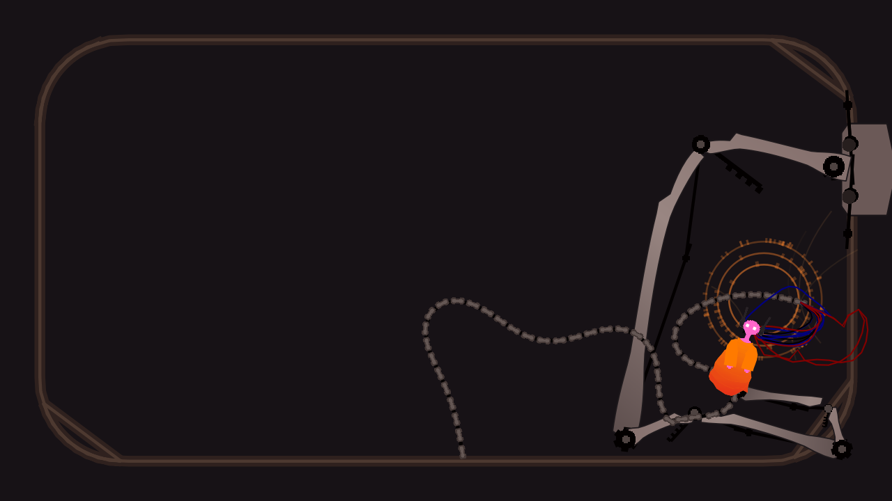

# Iterator Pet · 雨世界迭代器桌宠

一只 Five Pebbles（五块卵石）桌面宠物：透明置顶窗口，人偶吊在机械臂上，机械臂挂在沿屏幕边框滑动的滑车上，
后脑接着脐带缆与 14 根细股。所有姿态、物理常数与绘制顺序都按 Rain World 的 `Oracle` / `OracleGraphics`
反编译结果重实现（**不包含、不分发任何游戏代码或美术资源**）。



> 预览图由本仓库代码离线渲染：`python -m iterator_pet.main --preview out.png --width 1280 --height 720 --scale 2.2`

## 特性

- **40 TPS 定步长物理**，与游戏一致；渲染按 `alpha` 在两次物理帧之间插值（同游戏 `timeStacker`）。
- **缆车轨道**：圆角矩形四边，`framePos % 4`，象限交界走半径 = 边长 10% 的圆弧，内法线用球面插值过渡。
- **机械臂**：4 段 IK（`300 / 150 / 90 / 30`），肘部偏置力、可变最小长度、齿轮转角。
- **人偶**：2 个 `BodyChunk` 躯干 + 焊接头 + 手脚动态点、呼吸项、视线追踪。
- **脐带缆**：80 节主缆（10 px 节距、竹节鳞片 9×4.5 px）+ 14 根 × 20 节细股（50–200 px 自由长度，
  速度相关阻尼），从缆线尾插进后脑。
- **光环 / 长袍**：3 圈共 100 个 `MemoryBit` 与 11×11 布料网格。

## 运行

```bash
python -m pip install -r requirements.txt   # 或： pip install PySide6
$env:PYTHONPATH = "src"
python -m iterator_pet.main
```

托盘菜单可调速度、缩放、置顶、鼠标穿透；配置持久化在 `%LOCALAPPDATA%\IteratorPet\config.json`。

### 美术资源

精灵**不会**随仓库分发。启动时程序只读地从**你自己的** Rain World 安装里提取基础图元
（`Circle20` / `CentipedeSegment` / `pixel` 等）到 `%LOCALAPPDATA%\IteratorPet\cache\sprites\`。
找不到游戏时会退化为等价像素图元，仍可运行。安装路径可用环境变量覆盖：

```powershell
$env:RAINWORLD_DIR = "D:\SteamLibrary\steamapps\common\Rain World"
```

## 开发

```bash
python -m pytest -q                      # 38 项测试
python tools/selftest.py                 # 无依赖烟雾测试
python tools/puppet_portrait.py          # 1:1 人偶特写
python tools/roam_report.py 10           # 10 分钟漫游统计
python tools/cord_diag.py                # 缆线长度/拉伸数字
```

| 工具 | 用途 |
| --- | --- |
| `tools/selftest.py` | 不依赖 Qt 的冒烟测试 |
| `tools/smoke_window.py` | 真实窗口短跑并截图 |
| `tools/crop.py` | 放大截取局部，用于像素级判断 |
| `tools/puppet_portrait.py` | 人偶 1:1 特写 |
| `tools/leg_visibility.py` | 腿是否被袍子挡住的计算 |
| `tools/asset_sheet.py` | 抽取到的图元联络表 |
| `tools/probe_assets.py` | 只读探测本机游戏安装 |
| `tools/replay.py` | 定帧率确定性回放 |
| `tools/roam_report.py` | 漫游覆盖率 / 基座分布 |
| `tools/cord_diag.py`, `tools/cord_fold.py` | 缆线长度与折叠诊断 |

## 已知限制

- **漫游行为正在重做**：当前基座选择逻辑退化，人偶会长时间停留在屏幕一侧。正确设计（人偶主导、基座迟滞
  跟随、`1°/tick`、350/50 px 迟滞）记录在开发者文档中，尚未落地。
- `investigate` / `talk` 行为尚未实现（源码里它们由剧情动作驱动，桌宠需要一层评分器来选择）。
- 物理与绘制按 40 TPS + `1 px = 游戏 1 像素` 设计，`--scale 2.2` 是在 2K 屏上接近游戏观感的取值。

## 许可与致谢

代码以 MIT 许可发布（见 `LICENSE`）。Rain World 及其全部美术、音频、代码版权归 **Videocult / Akupara Games**
所有；本仓库不含任何游戏素材，仅在运行时从用户本机安装读取基础图元。
